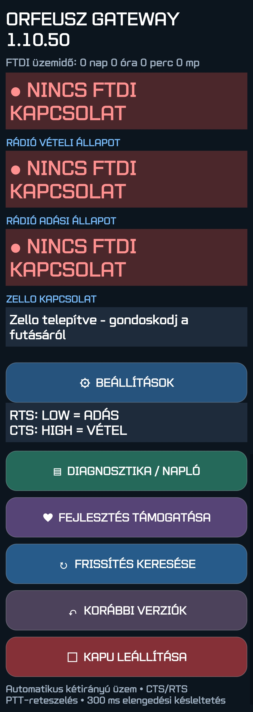
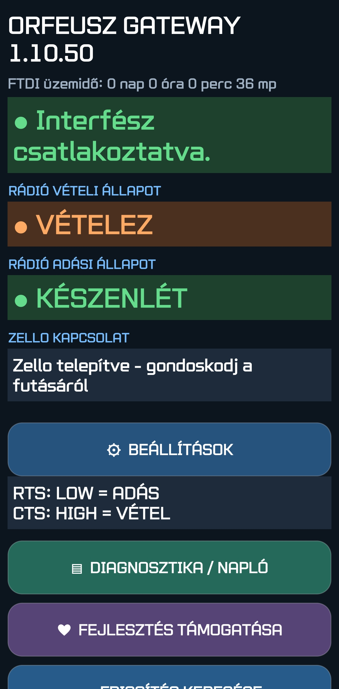
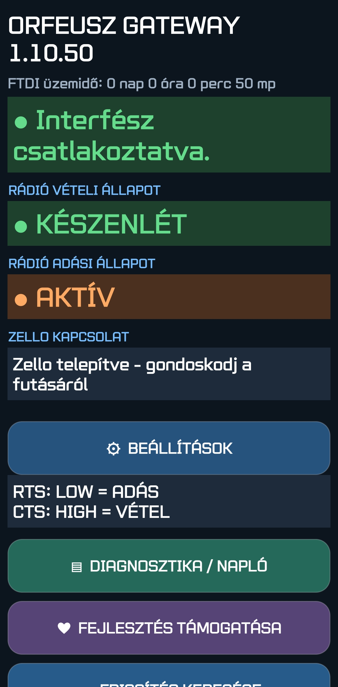

# Orfeusz Gateway

Android-based two-way Zello ↔ radio gateway application.

> **Important – additional radio hardware required:** a stock Baofeng radio and a simple connection cable are not sufficient. The setup requires a **modified Baofeng UV-5R or BF-888S radio**, a separate radio interface, and a USB–UART adapter connected to that interface. The verified USB–UART adapter is the **FTDI FT232R (VID: 0403, PID: 6001)**. I will publish the wiring diagrams and photos of the completed hardware soon.

## Required hardware and upcoming documentation

- Modified Baofeng UV-5R or BF-888S radio.
- Separate radio interface.
- Verified USB–UART adapter: FTDI FT232R (VID: 0403, PID: 6001).

**Coming soon:** I will upload wiring diagrams for the modified radio and radio interface, plus photos of the completed hardware assembly.

**Don't be intimidated by the build!** If you have soldered before, you should be able to assemble it by following the wiring diagrams with only basic soldering and electronics knowledge. You do not need advanced electronics skills – just a little patience and basic hands-on ability.

**Repository:** `szotsy/Zello-Android-Radio-Gateway`  
**Default branch:** `main`  
**Package:** `com.videotourzala.zellogateway`

## Screenshots

The following screenshots show the Orfeusz Gateway interface and its radio/FTDI status indicators.

| FTDI disconnected | FTDI connected / standby |
|---|---|
|  |  |

| Radio receiving | Radio transmitting |
|---|---|
|  |  |

## Current release and source status

- Latest published GitHub Release currently present in this repository: **1.10.47**.
- The latest locally prepared AndroidIDE source project is **1.10.50** (versionCode **87**). It is a source candidate and is **not a published APK release** until it has been built and tested in AndroidIDE.
- Do not create a GitHub Release for a source candidate before the APK has been built and verified.
- Release APKs and release notes are published on the [GitHub Releases page](https://github.com/szotsy/Zello-Android-Radio-Gateway/releases).

## Update architecture

### Legacy migration path

The root `update.json` is intentionally retained for installations that still use the old JSON-based updater. It points to **1.10.46** as the migration bridge. Do not delete it or change its version/URL without a deliberate migration decision.

### Current updater

Starting with 1.10.46, the app checks the latest stable GitHub Release through the GitHub Releases API:

`https://api.github.com/repos/szotsy/Zello-Android-Radio-Gateway/releases/latest`

Newer app versions do not need `update.json` to discover subsequent releases. The app compares the release tag with its installed Gradle version and only looks for an APK asset when a newer release is available.

## Release asset naming

For a release tag such as `1.10.47`, the APK asset must be named exactly:

`Orfeusz.Gateway_v1.10.47.apk`

The release tag and APK asset filename are separate values and both must match the intended release.

## Hardware compatibility

### 🇭🇺 Magyar

**Igazolt adapter: FTDI FT232R – VID: 0403, PID: 6001.**

Az alkalmazás jelenleg kizárólag az FTDI FT232R USB–UART adapterrel tesztelt és igazoltan működőképes. Más FTDI típusok, CH340G és egyéb USB–UART adapterek támogatása nem igazolt, működésük nem garantált.

### 🇬🇧 English

**Verified adapter: FTDI FT232R – VID: 0403, PID: 6001.**

The application has been tested and verified to work with the FTDI FT232R USB–UART adapter only. Other FTDI models, CH340G and other USB–UART adapters are not verified or guaranteed to work.

### 🇩🇪 Deutsch

**Bestätigter Adapter: FTDI FT232R – VID: 0403, PID: 6001.**

Die Anwendung wurde ausschließlich mit dem FTDI FT232R USB–UART-Adapter getestet und dessen Funktion bestätigt. Andere FTDI-Modelle, CH340G und sonstige USB–UART-Adapter sind nicht verifiziert; ihre Funktion ist nicht garantiert.

### 🇷🇺 Русский

**Проверенный адаптер: FTDI FT232R – VID: 0403, PID: 6001.**

Работа приложения проверена и подтверждена только с USB–UART адаптером FTDI FT232R. Совместимость с другими моделями FTDI, CH340G и другими USB–UART адаптерами не подтверждена и не гарантируется.

## Radio gateway safety

- FTDI RTS/CTS and PTT control are safety-critical to the gateway operation.
- Do not change the radio-control logic as part of unrelated UI, updater or documentation work.
- The Zello installation reminder is not proof of a live Zello server connection.
- Updates are manually initiated; automatic background update checks and automatic installation are intentionally not used.

## Development notes

The AndroidIDE source project is prepared separately as a versioned ZIP package. A source candidate must be synchronized, built and tested in AndroidIDE before its APK is published as a GitHub Release. Keep the Gradle `versionName`, `versionCode`, in-app version display, diagnostic output and release notes synchronized.
