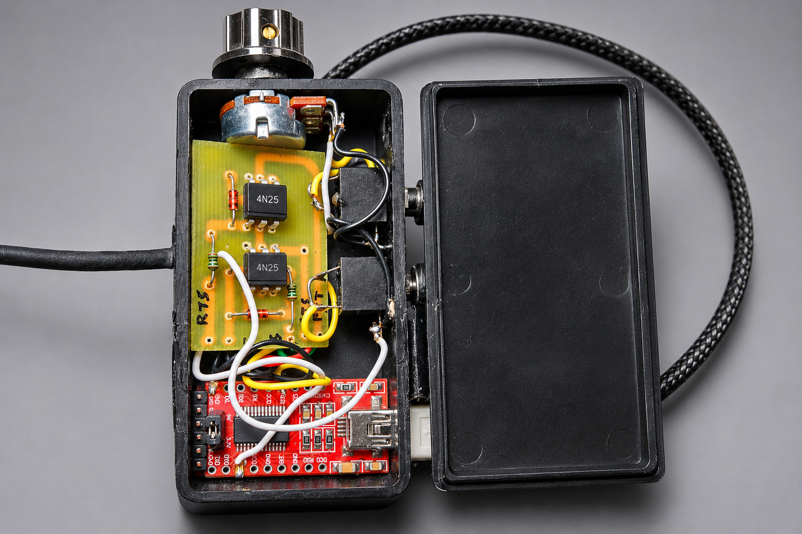
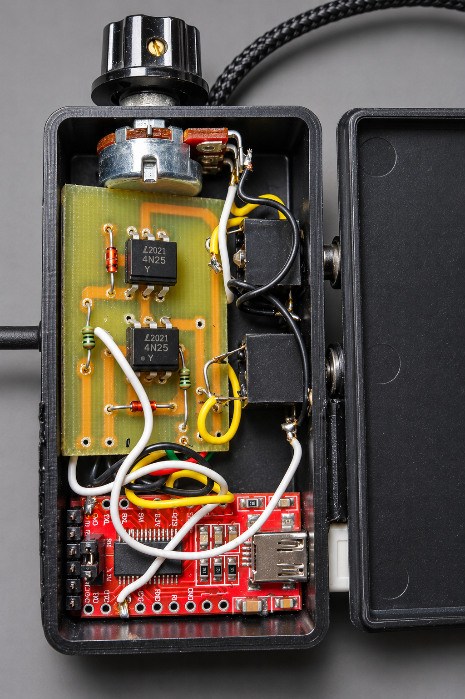
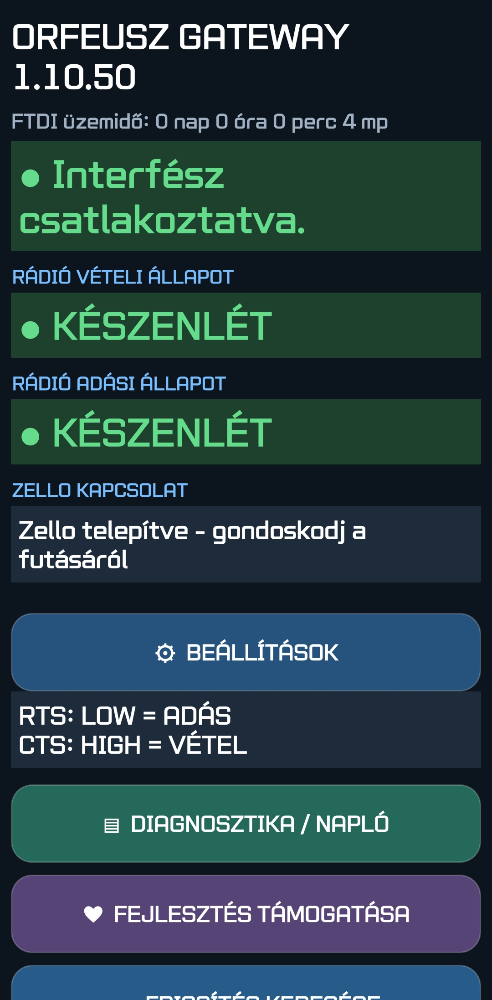

# Orfeusz Gateway

Android-based two-way Zello ↔ radio gateway application.

   

**[📚 HU / EN documentation and knowledge base](wiki/README.md)** – Photos and screenshots will be added in a later update.

## ⬇️ Orfeusz Gateway – Download APK

**[⬇️ DOWNLOAD APK – direct, one-click download](https://github.com/szotsy/Zello-Android-Radio-Gateway/releases/latest/download/Orfeusz.Gateway.apk)**

The link above always downloads the installer from the latest stable release. You do not need to search through the GitHub Assets list.

[View all releases and previous versions](https://github.com/szotsy/Zello-Android-Radio-Gateway/releases)

> **Licence:** this project uses a custom restrictive licence and is not distributed under an OSI-approved open-source licence. Use and unchanged redistribution of the APK are permitted; modifying the source code or distributing modified versions requires prior written permission. See [LICENSE](LICENSE) for the full terms.

## Download and installation

**Most users do not need to clone the source code or use Android Studio.** Download the ready-to-install APK from the official GitHub Releases page.

### 1. Download the APK

1. Open the [latest Orfeusz Gateway release on GitHub](https://github.com/szotsy/Zello-Android-Radio-Gateway/releases/latest).
2. Under **Assets** in the latest release, find the installer file with the `.apk` extension. Its name looks like `Orfeusz.Gateway_v1.10.62.apk`.
3. Tap the APK file to download it to your phone.
4. Only install APKs from the official project page above. The **Source code (zip)** and **Source code (tar.gz)** files contain developer source code; they are not the installer intended for regular users.

### 2. Install on Android

1. Open the downloaded APK from the notification shade or your phone's **Downloads** folder.
2. If Android asks, allow the app you used to open the file – such as your browser or file manager – to install apps from that source. Depending on the Android version and manufacturer, this setting may be called **Install unknown apps** or similar.
3. Return to the installer and tap **Install**.
4. When installation is complete, open **Orfeusz Gateway**.

If an earlier version is already installed, a newer official APK can normally be installed as an update. If Android reports a signature or package conflict, do not automatically uninstall the existing app; first verify that you downloaded the correct official release.

### 3. First launch and radio connection

1. On first launch, review and grant the Android permissions actually requested by the application.
2. Connect the verified **FTDI FT232R USB–UART adapter** to the radio interface and the Android device. Approve Android's USB-device access prompt.
3. Radio operation requires the following hardware: a modified **Baofeng UV-5R or BF-888S**, a separate radio interface, and an FTDI FT232R adapter (VID: 0403, PID: 6001). See the [English wiring guide](https://szotsy.github.io/Zello-Android-Radio-Gateway/wiring-en.html) for the detailed connections.
4. The Zello app must also be installed and configured for use on the Android device.
5. Check the connection status indicators in Orfeusz Gateway before starting radio traffic.

**Important:** installing the app alone does not create a working radio gateway. Compatible and correctly wired radio hardware, the Zello app, reliable power and an internet connection are also required.

### Security notice

Because the app is installed directly from GitHub rather than the Google Play Store, Android or Play Protect may display a warning. This alone does not prove that the app is malicious, but **do not ignore a specific malware detection**. Always verify the download source and use only files published on the official [GitHub Releases](https://github.com/szotsy/Zello-Android-Radio-Gateway/releases/latest) page.

## What is Orfeusz Gateway for?

**Orfeusz Gateway** is an Android-based radio gateway application that enables two-way communication between conventional radio traffic and the Zello network.

Radio transmissions received from a conventional radio can be forwarded to Zello users, while audio coming from Zello can be transmitted through the connected radio. This allows users of the two different communication systems to communicate with one another.

It also means that people who do not own a handheld radio can take part in radio communication: all they need is an internet-connected smartphone running the Zello app.

And the possibilities do not stop there. If another Zello gateway is operating in a different location, the two gateways can carry conventional radio traffic across enormous distances – potentially to the other side of the world.

**The more gateway stations connected to the same Zello channel, the more locations your transmission can reach.** Imagine sitting on your sofa at home, holding your little handheld radio, and reaching radio users in another city, another country or even another continent – provided that a suitably configured gateway is operating there too.

Orfeusz Gateway therefore **combines the simplicity of conventional radio with the geographical reach of the internet**, creating a genuine two-way communication link between radio and Zello.

> **Important – additional radio hardware required:** a stock Baofeng radio and a simple connection cable are not sufficient. The setup requires a **modified Baofeng UV-5R or BF-888S radio**, a separate radio interface, and a USB–UART adapter connected to that interface. The verified USB–UART adapter is the **FTDI FT232R (VID: 0403, PID: 6001)**. The radio interface wiring diagram and parts list are available in the [English wiring guide](https://szotsy.github.io/Zello-Android-Radio-Gateway/wiring-en.html); the [Hungarian guide](https://szotsy.github.io/Zello-Android-Radio-Gateway/wiring.html) is also available.

## Replacing legacy PC-based Zello gateways

Orfeusz Gateway is an Android-based alternative to legacy radio gateways built around the PC version of the Zello client. With the retirement of the old PC client, you do not necessarily have to abandon a radio gateway you already own: Orfeusz Gateway can bring a compatible existing setup back into service by moving the gateway operation to an Android device.

This lets you continue using your previously built radio system without relying on the PC-based Zello client, provided that its radio and interface hardware are compatible. **Important:** direct reuse depends on the existing hardware design; the application has currently been tested with a modified Baofeng UV-5R or BF-888S radio and the verified FTDI FT232R USB–UART adapter.

## Compact, self-contained mobile gateway – no PC required

One of the key advantages of Orfeusz Gateway is that the gateway does not require a separate laptop or desktop computer for operation. **The Android phone itself runs the application and performs the gateway's computing, networking and control tasks.** The radio interface and a compatible radio are connected to the phone; a suitable power source and internet connection are still required.

This makes it possible to build a simpler, compact mobile gateway. The host computer, display, battery and mobile network connection are already integrated into a single device. Compared with a Raspberry Pi-based setup, this can reduce the number of separate computer components and accessories that need to be assembled. This does not mean it is physically smaller than every Raspberry Pi: for example, the Raspberry Pi Zero 2 W is itself extremely small. The advantage is the integration of these functions into the phone and the simpler overall setup.

The mobile design supports several practical deployment scenarios:

- **Vehicle-mounted gateway:** during field deployments or events, the gateway can remain in a vehicle, turning it into a mobile communications node.
- **Portable unit:** the phone, radio and interface can be installed in a compact, properly secured and protected enclosure.
- **Temporary field deployment:** during hikes, operations across large areas or events, the gateway can be placed at a suitable location where stable power, internet access and radio coverage are available.

For field use, the equipment must be protected against rain, dust, overheating and mechanical damage. The phone-based design simplifies deployment, but it does not replace a suitable radio antenna, reliable power and an internet connection at the operating location.

## Required hardware and upcoming documentation

- Modified Baofeng UV-5R or BF-888S radio.
- Separate radio interface.
- Verified USB–UART adapter: FTDI FT232R (VID: 0403, PID: 6001).

**Wiring documentation:** the radio interface diagram and detailed parts list are available in the [English wiring guide](https://szotsy.github.io/Zello-Android-Radio-Gateway/wiring-en.html). The [Hungarian guide](https://szotsy.github.io/Zello-Android-Radio-Gateway/wiring.html) is also available.

**Don't be intimidated by the build!** If you have soldered before, you should be able to assemble it by following the wiring diagrams with only basic soldering and electronics knowledge. You do not need advanced electronics skills – just a little patience and basic hands-on ability.

**Repository:** `szotsy/Zello-Android-Radio-Gateway`  
**Default branch:** `main`  
**Package:** `com.videotourzala.zellogateway`

## Hardware gallery

The following presentation images were AI-re-rendered from photographs of the original Orfeusz Gateway system. They illustrate the appearance and general layout of the real system; however, due to the AI re-rendering, **the electrical circuit, wiring and small electronic details may not be accurate**. The radio interface wiring diagram and parts list are available in the [English wiring guide](https://szotsy.github.io/Zello-Android-Radio-Gateway/wiring-en.html). Use the verified diagram and check the actual pinout of your own components before assembly.

| Complete system | Radio interface | Internal electronics detail |
|---|---|---|
|  |  |  |

## Screenshots

The following screenshots show the Orfeusz Gateway interface and its radio/FTDI status indicators.

| FTDI disconnected | FTDI connected / standby |
|---|---|
|  |  |

| Radio receiving | Radio transmitting |
|---|---|
|  |  |

## Android security warnings and permissions

### If Android displays a security warning

Orfeusz Gateway is distributed through GitHub Releases rather than the Google Play Store. For that reason, Android or Google Play Protect may display a security notice during installation or request an additional scan. **Such a notice alone does not prove that an application is malicious.**

I develop this app specifically to provide two-way audio communication between Zello and a connected radio, and to control the FTDI radio interface. It is not designed to damage the device or deceive the user. Before installing, make sure you downloaded the APK from the project's official [GitHub Releases page](https://github.com/szotsy/Zello-Android-Radio-Gateway/releases/latest). I do not recommend installing renamed, modified or third-party APK files. If Android identifies a specific threat, do not dismiss the alert automatically; verify the file's origin and the authenticity of the release.

### Required Android permissions

For the application to work correctly, grant the Android permissions that it actually requests. Denying or later revoking permissions may restrict certain functions, such as audio handling or background operation, and can prevent the Zello-to-radio connection from working as intended.

- On first launch, review the Android permission prompts and grant the permissions requested for the app's operation.
- When connecting the FTDI USB adapter, also allow the USB-device access prompt displayed by Android.
- If you previously denied a permission, review it under **Android Settings → Apps → Orfeusz Gateway → Permissions**. Menu names may vary by Android version and device manufacturer.
- Grant permissions only to the official app, and approve only prompts that Android actually displays.

## Current release and source status

- Latest published GitHub Release: **1.10.62**.
- Version Code: **99**.
- The 1.10.62 APK is available on the [GitHub Releases page](https://github.com/szotsy/Zello-Android-Radio-Gateway/releases/latest).
- Publish a new GitHub Release only after the APK has been built and verified.

## 1.10.57 – Release notes

- Updated the foreground service notification title to **Orfeusz Gateway active**.
- Tapping the notification opens the Orfeusz Gateway application.
- The Zello connection status panel is clickable: it launches Zello or brings it to the foreground if it is already running.
- A warning is displayed if Zello cannot be launched.
- Notifications are available in Hungarian, English, German and Russian.
- Existing FTDI, USB, RTS, CTS and PTT control logic remains unchanged.

## Update architecture

### Legacy migration path

The root `update.json` is retained for compatibility with installations that still use the legacy JSON-based updater. It currently points to **1.10.62** and its APK.

### Current updater

Starting with 1.10.46, the app checks the latest stable GitHub Release through the GitHub Releases API:

`https://api.github.com/repos/szotsy/Zello-Android-Radio-Gateway/releases/latest`

Newer app versions do not need `update.json` to discover subsequent releases. The app compares the release tag with its installed Gradle version and only looks for an APK asset when a newer release is available.

## Publishing a release

See [RELEASE_PROCESS.md](RELEASE_PROCESS.md) for the build, device-verification and publishing checklist. The release workflow validates the versioned APK, creates the stable-name download asset and publishes a SHA-256 checksum.

## Release asset naming

For a release tag such as `1.10.50`, the APK asset must be named exactly:

`Orfeusz.Gateway_v1.10.50.apk`

The release tag and APK asset filename are separate values and both must match the intended release.

## Tested devices

I have tested the application on the following Android devices:

| Device | Test status |
|---|---|
| Samsung Galaxy S23 | Tested |
| Samsung Galaxy Tab A7 | Tested |

This list includes devices that have actually been tested. Compatibility with other devices and Android versions is not implied.

## Android version compatibility

- **Minimum supported Android version: Android 6.0 (Marshmallow, API 23).**
- The source project's minSdk setting allows installation on Android 6.0 and newer versions.
- Zello package visibility queries are declared in the manifest for Android 11 and later; this does not restrict operation on older Android versions.
- The minimum Android version is a project configuration requirement, not a claim that every Android release or device has been individually tested. See “Tested devices” for the devices actually tested.

## 1.10.62 – Release notes

- Large screens (available width of at least 700 dp) use a two-column layout: FTDI, radio and Zello status indicators on the left; action buttons on the right.
- Narrow phone screens retain the original single-column layout.
- The scroll-down arrow is shown only when additional scrollable content exists.
- Zello installation state refresh is event-driven; no continuous polling is used.
- The Zello Play Store link uses the `com.loudtalks` package ID.
- FTDI, USB, RTS, CTS and PTT control logic remains unchanged.

**Version Code:** 99 · **Minimum Android:** 6.0 (API 23)

APK: [Orfeusz.Gateway_v1.10.62.apk](https://github.com/szotsy/Zello-Android-Radio-Gateway/releases/download/1.10.62/Orfeusz.Gateway_v1.10.62.apk).

## Hardware compatibility

### 🇬🇧 English

**Verified adapter: FTDI FT232R – VID: 0403, PID: 6001.**

The application has been tested and verified to work with the FTDI FT232R USB–UART adapter only. Other FTDI models, CH340G and other USB–UART adapters are not verified or guaranteed to work.

### 🇩🇪 Deutsch

**Bestätigter Adapter: FTDI FT232R – VID: 0403, PID: 6001.**

Die Anwendung wurde ausschließlich mit dem FTDI FT232R USB–UART-Adapter getestet und dessen Funktion bestätigt. Andere FTDI-Modelle, CH340G und sonstige USB–UART-Adapter sind nicht verifiziert; ihre Funktion ist nicht garantiert.

### 🇷🇺 Русский

**Проверенный адаптер: FTDI FT232R – VID: 0403, PID: 6001.**

Работа приложения проверена и подтверждена только с USB–UART адаптером FTDI FT232R. Совместимость с другими моделями FTDI, CH340G и другими USB–UART адаптерами не подтверждена и не гарантируется.

## Radio gateway safety

- FTDI RTS/CTS and PTT control are safety-critical to the gateway operation.
- Do not change the radio-control logic as part of unrelated UI, updater or documentation work.
- The Zello installation reminder is not proof of a live Zello server connection.
- Updates are manually initiated; automatic background update checks and automatic installation are intentionally not used.

## Development notes

The AndroidIDE source project is prepared separately as a versioned ZIP package. The source project is versioned separately; release build and device verification are completed before publication. Keep the Gradle `versionName`, `versionCode`, in-app version display, diagnostic output and release notes synchronized.

## Licence and contributions

The GitHub repository is public, but **public visibility does not grant permission to modify or build derivative versions**. This project uses a custom licence and is not distributed under an OSI-approved open-source licence. The source code may be viewed and downloaded; modification, adaptation and distribution of modified versions require the rights holder's prior written permission. Use and unchanged redistribution of the unmodified APK are governed by the terms in the LICENSE file.

## Trademark disclaimer and independence

**Orfeusz Gateway is an independent third-party project**, distributed free of charge. No purchase price or licence fee is charged for the application. The project is not affiliated with Zello, Inc., is not an official Zello product, and is not sponsored, endorsed or officially supported by Zello.

The **Zello** name and related trademarks are the property of Zello, Inc. The name is used solely to describe compatibility and related functionality accurately. The Orfeusz Gateway name, branding and project are independent and do not imply an official partnership or endorsement.
