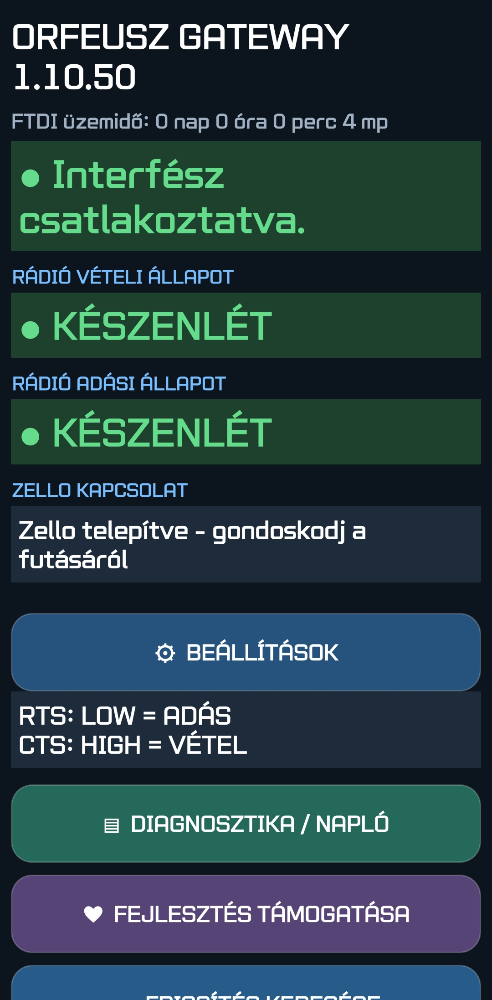
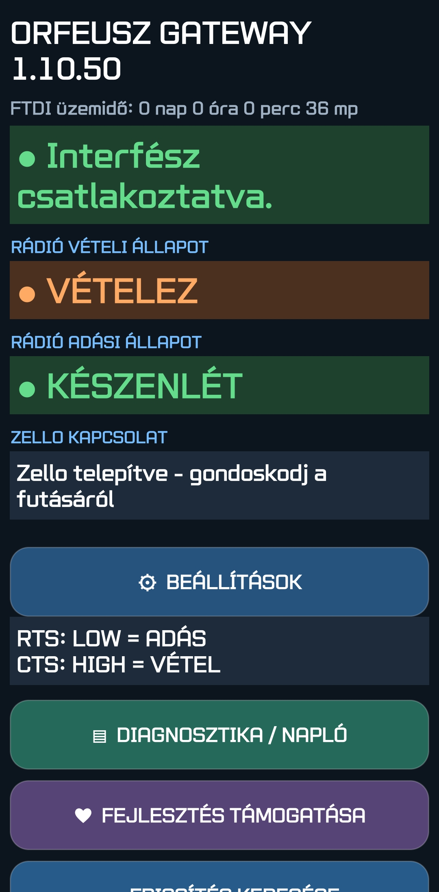
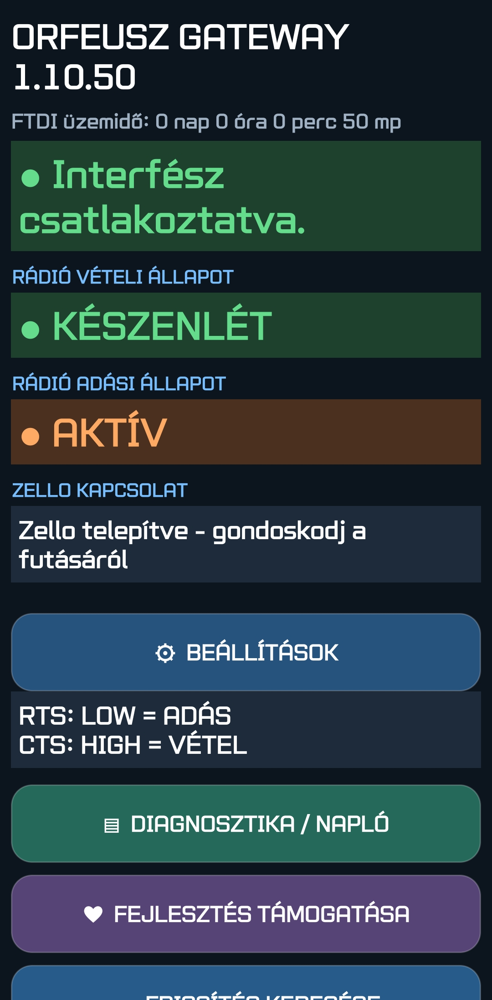

# Orfeusz Gateway

Androidos, kétirányú Zello–rádió kapuállomás.

## Mire szolgál az Orfeusz Gateway?

Az **Orfeusz Gateway** egy Android-alapú rádiós átjáróalkalmazás, amely lehetővé teszi a hagyományos rádióforgalom és a Zello-hálózat kétirányú összekapcsolását.

A rendszer segítségével a hagyományos rádióval leadott adás eljuthat a Zello felhasználóihoz, a Zello felől érkező hang pedig továbbítható a csatlakoztatott rádióra. Így a két különböző kommunikációs rendszer használói közvetlenül kommunikálhatnak egymással.

Ennek köszönhetően azok is bekapcsolódhatnak a rádiós kommunikációba, akiknek nincs saját kézi rádiójuk: elegendő egy internetkapcsolattal rendelkező okostelefon és a Zello alkalmazás.

A lehetőségek azonban itt nem érnek véget! Ha egy másik földrajzi helyen is működik egy Zello-kapuállomás, a két kapuállomás segítségével a hagyományos rádióforgalom akár a világ másik felére is eljuthat.

**Minél több kapuállomás csatlakozik ugyanahhoz a Zello-csoporthoz, annál több földrajzi helyre juthat el az adásod.** Gondolj bele: akár otthon, a kanapén ülve, a kezedben tartott kis kézi rádióval is megszólíthatsz másik városban, országban vagy akár egy másik kontinensen lévő rádiósokat – feltéve, hogy ott is működik egy megfelelően beállított kapuállomás.

Az Orfeusz Gateway tehát **összekapcsolja a hagyományos rádiózás egyszerűségét az internet által biztosított földrajzi szabadsággal**, valódi, kétirányú kommunikációs lehetőséget teremtve a rádió és a Zello között.

> **Fontos – szükséges rádiós hardver:** az alkalmazás használatához nem elegendő egy gyári Baofeng rádió és egy egyszerű csatlakozókábel. **Átalakított Baofeng UV-5R vagy BF-888S rádió szükséges**, továbbá egy külön rádióinterfész és az interfészhez csatlakozó USB–UART adapter. Az igazolt USB–UART adapter típusa: **FTDI FT232R (VID: 0403, PID: 6001)**. A kapcsolási rajzokat és a megépített rendszer fényképeit hamarosan közzéteszem.

## Szükséges hardver és dokumentáció

- Átalakított Baofeng UV-5R vagy BF-888S rádió.
- Külön rádióinterfész.
- Igazolt USB–UART adapter: FTDI FT232R (VID: 0403, PID: 6001).

**Hamarosan:** feltöltöm az átalakított rádió és a rádióinterfész kapcsolási rajzait, valamint a megépített hardverről készült fényképeket.

**Nem kell megijedni az építéstől!** Ha forrasztottál már korábban, a kapcsolási rajzok alapján minimális forrasztási és elektronikai ismerettel is meg tudod építeni. Nem szükséges hozzá komoly elektronikai szaktudás – egy kis türelem és alapvető kézügyesség elegendő.

- Csomagnév: `com.videotourzala.zellogateway`
- GitHub-repó: `szotsy/Zello-Android-Radio-Gateway`
- Alapértelmezett ág: `main`

## Képernyőképek

Az alábbi képek az Orfeusz Gateway felületét, valamint a rádió és az FTDI adapter állapotjelzéseit mutatják be.

| FTDI nincs csatlakoztatva | FTDI csatlakoztatva / készenlét |
|---|---|
|  |  |

| Rádió vétel | Rádió adás |
|---|---|
|  |  |

## Kiadási állapot

- A repóban jelenleg elérhető legfrissebb publikált GitHub Release: **1.10.47**.
- A legutóbb előkészített AndroidIDE-forrásjelölt: **1.10.50**, versionCode **87**.
- Az 1.10.50 egyelőre forrásjelölt: APK-build és AndroidIDE-teszt nélkül nem tekinthető kiadott verziónak.
- Új GitHub Release csak a ténylegesen lefordított és ellenőrzött APK-val készüljön.

## Frissítési rendszer

### Régi telepítések migrációja

A gyökérben lévő `update.json` szándékosan megmarad. A régi, JSON-alapú frissítést használó telepítéseket az **1.10.46** migrációs verzióra irányítja. Törölni vagy átírni csak külön migrációs döntés alapján szabad.

### Új frissítési rendszer

Az 1.10.46-tól az alkalmazás a GitHub Releases API-n keresztül keresi a legújabb stabil kiadást:

`https://api.github.com/repos/szotsy/Zello-Android-Radio-Gateway/releases/latest`

Az alkalmazás a GitHub Release tagjét a telepített Gradle-verzióval hasonlítja össze. APK-assetet csak akkor keres, ha valóban újabb kiadás érhető el.

## APK-elnevezés

A release tag és az APK neve egyezzen a kiadás verziójával. Például az 1.10.47 kiadás APK assetje:

`Orfeusz.Gateway_v1.10.47.apk`

## Hardverkompatibilitás

**Igazolt adapter: FTDI FT232R – VID: 0403, PID: 6001.**

Az alkalmazás jelenleg kizárólag az FTDI FT232R USB–UART adapterrel tesztelt és igazoltan működőképes. Más FTDI típusok, CH340G és egyéb USB–UART adapterek támogatása nem igazolt, működésük nem garantált.

## Üzembiztonság

- Az FTDI RTS/CTS és PTT vezérlés a kapuállomás kritikus működési része.
- Más funkciók vagy felületi elemek módosításakor a rádióvezérlési logikát nem szabad indokolatlanul megváltoztatni.
- A „Zello telepítve” jelzés nem bizonyítja az élő Zello-kapcsolatot.
- A frissítés kézzel indítható; automatikus háttér-ellenőrzés és automatikus telepítés nincs.

## Fejlesztési szabályok

- A Gradle `versionName` és `versionCode`, az alkalmazásban megjelenő verzió, a diagnosztikai napló és a kiadási leírás legyen összhangban.
- Az alkalmazás verzióját a kód a Gradle által generált BuildConfig adatokból olvassa.
- A forrásjelölt AndroidIDE-ben történő buildelése és tesztelése kötelező a publikálás előtt.
- A teljes AndroidIDE-forrásprojekt külön, verziószámmal elnevezett ZIP-csomagban készül.
