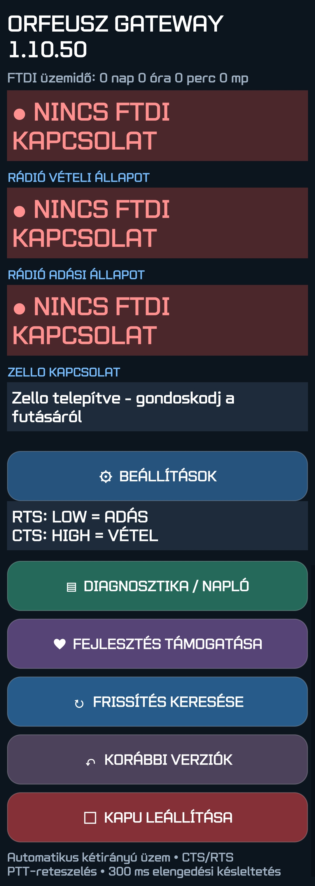

# Orfeusz Gateway

Androidos, kétirányú Zello–rádió kapuállomás.

   

## Mire szolgál az Orfeusz Gateway?

Az **Orfeusz Gateway** egy Android-alapú rádiós átjáróalkalmazás, amely lehetővé teszi a hagyományos rádióforgalom és a Zello-hálózat kétirányú összekapcsolását.

A rendszer segítségével a hagyományos rádióval leadott adás eljuthat a Zello felhasználóihoz, a Zello felől érkező hang pedig továbbítható a csatlakoztatott rádióra. Így a két különböző kommunikációs rendszer használói közvetlenül kommunikálhatnak egymással.

Ennek köszönhetően azok is bekapcsolódhatnak a rádiós kommunikációba, akiknek nincs saját kézi rádiójuk: elegendő egy internetkapcsolattal rendelkező okostelefon és a Zello alkalmazás.

A lehetőségek azonban itt nem érnek véget! Ha egy másik földrajzi helyen is működik egy Zello-kapuállomás, a két kapuállomás segítségével a hagyományos rádióforgalom akár a világ másik felére is eljuthat.

**Minél több kapuállomás csatlakozik ugyanahhoz a Zello-csoporthoz, annál több földrajzi helyre juthat el az adásod.** Gondolj bele: akár otthon, a kanapén ülve, a kezedben tartott kis kézi rádióval is megszólíthatsz másik városban, országban vagy akár egy másik kontinensen lévő rádiósokat – feltéve, hogy ott is működik egy megfelelően beállított kapuállomás.

Az Orfeusz Gateway tehát **összekapcsolja a hagyományos rádiózás egyszerűségét az internet által biztosított földrajzi szabadsággal**, valódi, kétirányú kommunikációs lehetőséget teremtve a rádió és a Zello között.

> **Fontos – szükséges rádiós hardver:** az alkalmazás használatához nem elegendő egy gyári Baofeng rádió és egy egyszerű csatlakozókábel. **Átalakított Baofeng UV-5R vagy BF-888S rádió szükséges**, továbbá egy külön rádióinterfész és az interfészhez csatlakozó USB–UART adapter. Az igazolt USB–UART adapter típusa: **FTDI FT232R (VID: 0403, PID: 6001)**. A kapcsolási rajzokat és a megépített rendszer fényképeit hamarosan közzéteszem.

## A régi PC-s Zello-kapuállomások kiváltása

Az Orfeusz Gateway a korábbi, PC-n futó Zello-kliensre épülő rádiós kapuállomások Android-alapú alternatívája. A régi PC-s Zello-kliens kivezetése után sem kell feltétlenül lemondanod a már meglévő rádiós kapuállomásodról: az Orfeusz Gateway segítségével ismét használatba veheted, és a kapuállomás működését egy Android-eszközre helyezheted át.

Így a korábban kiépített rádiós rendszered – megfelelő, kompatibilis rádióval és interfésszel – tovább használható, PC-s Zello-kliens nélkül. **Fontos:** a meglévő hardver közvetlen újrahasználhatósága a kialakításától függ; az alkalmazás jelenleg az átalakított Baofeng UV-5R vagy BF-888S rádióval és az igazolt FTDI FT232R USB–UART adapterrel tesztelt.

## Kompakt, önálló mobil kapuállomás – számítógép nélkül

Az Orfeusz Gateway egyik legnagyobb előnye, hogy a kapuállomás vezérléséhez nincs szükség külön laptopra vagy asztali számítógépre. **Maga az Androidos telefon futtatja az alkalmazást és látja el a gateway számítási, hálózati és vezérlési feladatait.** A telefonhoz a rádióinterfészt és a megfelelő rádiót kell csatlakoztatni; a működéshez természetesen tápellátásra és internetkapcsolatra is szükség van.

Ezzel egy egyszerűbb, kompakt mobil kapuállomás építhető, amelynél a központi számítógép, a kijelző, az akkumulátor és a mobil adatkapcsolat egyetlen készülékben rendelkezésre áll. Egy Raspberry Pi-alapú megoldáshoz képest így kevesebb különálló számítógépes alkatrészt és kiegészítőt kell összeállítani. Ez nem jelenti azt, hogy minden Raspberry Pi-nél fizikailag kisebb: például a Raspberry Pi Zero 2 W önmagában is rendkívül apró. Az előny a telefonba integrált funkciókban és az egyszerűbb rendszer-összeállításban rejlik.

A mobil kialakítás többféle felhasználást tesz lehetővé:

- **Járműbe telepítve:** kitelepülés vagy rendezvény idején a kapuállomás az autóban maradhat, így a jármű mobil kommunikációs csomópontként működhet.
- **Hordozható egységként:** a telefon, a rádió és az interfész egy kompakt, megfelelően rögzített és védett dobozba építhető.
- **Ideiglenes terepi telepítésként:** túrák, nagy kiterjedésű területek bejárása vagy rendezvények során a kapuállomás egy alkalmas helyen kihelyezhető, ha ott biztosítható a stabil tápellátás, az internetkapcsolat és a rádiós lefedettség.

A terepi használatnál a készülékeket védeni kell az esőtől, portól, túlmelegedéstől és mechanikai sérülésektől. A mobiltelefonos kialakítás egyszerűsíti a kapuállomás telepítését, de nem helyettesíti a megfelelő rádiós antennát, a stabil tápellátást és a használati helyen elérhető internetkapcsolatot.

## Szükséges hardver és dokumentáció

- Átalakított Baofeng UV-5R vagy BF-888S rádió.
- Külön rádióinterfész.
- Igazolt USB–UART adapter: FTDI FT232R (VID: 0403, PID: 6001).

**Hamarosan:** feltöltöm az átalakított rádió és a rádióinterfész kapcsolási rajzait, valamint a megépített hardverről készült fényképeket.

**Nem kell megijedni az építéstől!** Ha forrasztottál már korábban, a kapcsolási rajzok alapján minimális forrasztási és elektronikai ismerettel is meg tudod építeni. Nem szükséges hozzá komoly elektronikai szaktudás – egy kis türelem és alapvető kézügyesség elegendő.

- Csomagnév: `com.videotourzala.zellogateway`
- GitHub-repó: `szotsy/Zello-Android-Radio-Gateway`
- Alapértelmezett ág: `main`

## Hardvergaléria

A következő képek az eredeti Orfeusz Gateway rendszerről készült fényképek alapján, AI segítségével újrarenderelt bemutatóképek. A képek az eredeti rendszer megjelenését és felépítését szemléltetik, azonban az újrarenderelés miatt **az elektromos kapcsolás, a bekötések és az apró elektronikai részletek nem feltétlenül pontosak**. A pontos kapcsolási rajzok és műszaki dokumentáció összeállítása és feltöltése folyamatban van; ezek lesznek a hiteles hivatkozási alapok a hardver megépítéséhez.

| A teljes rendszer | A rádióinterfész | Belső elektronikai részlet |
|---|---|---|
|  |  |  |

## Képernyőképek

Az alábbi képek az Orfeusz Gateway felületét, valamint a rádió és az FTDI adapter állapotjelzéseit mutatják be.

| FTDI nincs csatlakoztatva | FTDI csatlakoztatva / készenlét |
|---|---|
|  |  |

| Rádió vétel | Rádió adás |
|---|---|
|  |  |

## Android-biztonsági figyelmeztetések és engedélyek

### Ha az Android figyelmeztet az alkalmazásra

Az Orfeusz Gateway-t a GitHub Releases oldalról, a Google Play Áruházon kívül lehet letölteni és telepíteni. Emiatt az Android vagy a Google Play Protect a telepítéskor biztonsági figyelmeztetést jeleníthet meg, illetve külön ellenőrzést kérhet. **Egy ilyen figyelmeztetés önmagában nem bizonyítja, hogy az alkalmazás kártékony.**

Az alkalmazást kifejezetten a Zello és a csatlakoztatott rádió közötti kétirányú hangkapcsolat, valamint az FTDI rádióinterfész vezérlésére fejlesztem. Nem célja a készülék károsítása vagy a felhasználó megtévesztése. A telepítés előtt mindig ellenőrizd, hogy az APK-t a projekt hivatalos [GitHub Releases oldaláról](https://github.com/szotsy/Zello-Android-Radio-Gateway/releases/latest) töltötted-e le. Ismeretlen forrásból származó, átnevezett vagy módosított APK telepítését nem javaslom. Ha a rendszer konkrét kártevőt azonosít, ne hagyd figyelmen kívül a jelzést; ellenőrizd a fájl eredetét és a kiadás hitelességét.

### Szükséges Android-engedélyek

A hibátlan működéshez az alkalmazás által ténylegesen kért Android-engedélyeket meg kell adni. Az engedélyek megtagadása vagy későbbi visszavonása egyes funkciókat – például a hangkezelést vagy a háttérben történő működést – korlátozhatja, ezért a Zello és a rádió közötti kapcsolat nem feltétlenül fog megfelelően működni.

- Első indításkor olvasd el az Android engedélykéréseit, és add meg az alkalmazás működéséhez kért engedélyeket.
- USB-s FTDI adapter csatlakoztatásakor engedélyezd az Android által megjelenített USB-eszköz-hozzáférést is.
- Ha korábban megtagadtál egy engedélyt, az Android **Beállítások → Alkalmazások → Orfeusz Gateway → Engedélyek** menüpontjában ellenőrizheted és módosíthatod. A menüpontok neve Android-verziónként és gyártónként eltérhet.
- Az engedélyeket csak a hivatalos alkalmazásnak add meg, és csak az Android által ténylegesen felkínált kéréseket hagyd jóvá.

## Kiadási állapot

- Legfrissebb publikált GitHub Release: **1.10.62**.
- Version Code: **99**.
- Az 1.10.62 APK letölthető a [GitHub Releases oldalról](https://github.com/szotsy/Zello-Android-Radio-Gateway/releases/latest).
- Új GitHub Release csak a ténylegesen lefordított és ellenőrzött APK-val készüljön.

## 1.10.57 – Kiadási megjegyzések

- A háttérszolgáltatás értesítésének címe: **Orfeusz Gateway aktív**.
- Az értesítésre koppintva megnyílik az Orfeusz Gateway alkalmazás.
- A Zello-kapcsolati állapotjelző panel kattintható: elindítja a Zello alkalmazást, vagy előtérbe hozza, ha már fut.
- Figyelmeztetés jelenik meg, ha a Zello nem indítható el.
- Az értesítések magyar, angol, német és orosz nyelven érhetők el.
- A meglévő FTDI-, USB-, RTS-, CTS- és PTT-vezérlési logika változatlan maradt.

## Frissítési rendszer

### Régi telepítések migrációja

A gyökérben lévő `update.json` szándékosan megmarad. A régi, JSON-alapú frissítést használó telepítéseket az **1.10.46** migrációs verzióra irányítja. Törölni vagy átírni csak külön migrációs döntés alapján szabad.

### Új frissítési rendszer

Az 1.10.46-tól az alkalmazás a GitHub Releases API-n keresztül keresi a legújabb stabil kiadást:

`https://api.github.com/repos/szotsy/Zello-Android-Radio-Gateway/releases/latest`

Az alkalmazás a GitHub Release tagjét a telepített Gradle-verzióval hasonlítja össze. APK-assetet csak akkor keres, ha valóban újabb kiadás érhető el.

## APK-elnevezés

A release tag és az APK neve egyezzen a kiadás verziójával. Például az 1.10.50 kiadás APK assetje:

`Orfeusz.Gateway_v1.10.50.apk`

## Tesztelt készülékek

Az alkalmazást az alábbi Android-eszközökön teszteltem:

| Készülék | Tesztállapot |
|---|---|
| Samsung Galaxy S23 | Tesztelve |
| Samsung Galaxy Tab A7 | Tesztelve |

A felsorolás a ténylegesen tesztelt készülékeket tartalmazza. Más készülékeken és Android-verziókon a működés nincs automatikusan igazolva.

## Android-verzió kompatibilitás

- **Minimálisan támogatott Android-verzió: Android 6.0 (Marshmallow, API 23).**
- A forrásprojekt minSdk beállítása alapján az alkalmazás Android 6.0-tól újabb Android-verziókon is telepíthető.
- Az Android 11-től bevezetett csomagláthatósági szabályokat a Manifestben deklarált Zello-csomaglekérdezések kezelik; ez a régebbi Android-verziók működését nem korlátozza.
- A minimális Android-verzió a projekt beállítása, nem jelenti azt, hogy minden Android-verzióval és készülékkel külön tesztelve lett. A ténylegesen tesztelt készülékeket a „Tesztelt készülékek” rész sorolja fel.

## 1.10.62 – Kiadási megjegyzések

- Nagy képernyőkön (legalább 700 dp rendelkezésre álló szélességnél) kétoszlopos elrendezés: bal oldalon az FTDI-, rádió- és Zello-állapotjelzések, jobb oldalon a kezelőgombok.
- Keskeny, telefonos képernyőkön megmarad az eredeti egyoszlopos elrendezés.
- A lefelé görgetést jelző nyíl csak akkor látható, ha további görgethető tartalom van.
- A Zello telepítettségi állapotának frissítése eseményvezérelt; nincs folyamatos lekérdezés.
- A Zello Play Áruház-hivatkozása a `com.loudtalks` csomagazonosítót használja.
- Az FTDI-, USB-, RTS-, CTS- és PTT-vezérlési logika változatlan.

**Version Code:** 99 · **Minimum Android:** 6.0 (API 23)

A kiadás APK-ja: [Orfeusz.Gateway_v1.10.62.apk](https://github.com/szotsy/Zello-Android-Radio-Gateway/releases/download/1.10.62/Orfeusz.Gateway_v1.10.62.apk).

## Hardverkompatibilitás

**Igazolt adapter: FTDI FT232R – VID: 0403, PID: 6001.**

Az alkalmazás jelenleg kizárólag az FTDI FT232R USB–UART adapterrel tesztelt és igazoltan működőképes. Más FTDI típusok, CH340G és egyéb USB–UART adapterek támogatása nem igazolt, működésük nem garantált.

## Üzembiztonság

- Az FTDI RTS/CTS és PTT vezérlés a kapuállomás kritikus működési része.
- Más funkciók vagy felületi elemek módosításakor a rádióvezérlési logikát nem szabad indokolatlanul megváltoztatni.
- A „Zello telepítve” jelzés nem bizonyítja az élő Zello-kapcsolatot.
- A frissítés kézzel indítható; automatikus háttér-ellenőrzés és automatikus telepítés nincs.

## Fejlesztési szabályok

- A Gradle `versionName` és `versionCode`, az alkalmazásban megjelenő verzió, a diagnosztikai napló és a kiadási leírás legyen összhangban.
- Az alkalmazás verzióját a kód a Gradle által generált BuildConfig adatokból olvassa.
- A buildelést és a készüléken történő ellenőrzést a kiadás publikálása előtt külön el kell végezni.
- A teljes AndroidIDE-forrásprojekt külön, verziószámmal elnevezett ZIP-csomagban készül.

## Védjegynyilatkozat és függetlenség

Az **Orfeusz Gateway független, külső fejlesztésű projekt**, amelyet ingyenesen terjesztek. Az alkalmazásért nem kérek vételárat vagy licencdíjat. A projekt nem áll kapcsolatban a Zello, Inc. vállalattal, nem annak hivatalos terméke, és nem rendelkezik a Zello hivatalos támogatásával, szponzorációjával vagy jóváhagyásával.

A **Zello** név és a kapcsolódó védjegyek jogosultja a Zello, Inc. A megnevezést kizárólag a kompatibilitás és a kapcsolódó funkcionalitás tényszerű leírására használom. Az Orfeusz Gateway név, arculat és projekt önálló; a megjelenítés nem sugall hivatalos partnerséget vagy jóváhagyást.
