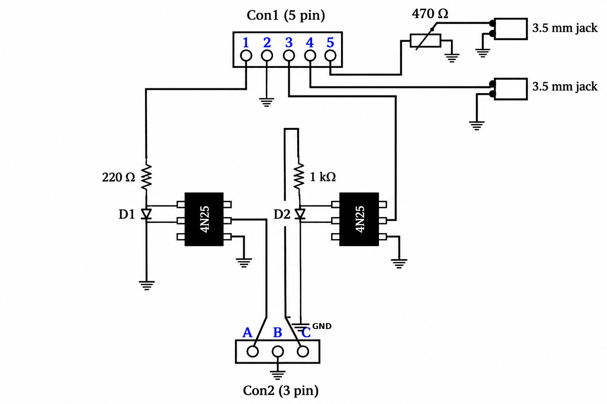

# Hardver és bekötés / Hardware and wiring

> **A fejezet később további fotókkal és feliratozott ábrákkal bővül. / More photos and annotated illustrations will be added later.**

## Magyar

### Ellenőrzött adapter
Az alkalmazással ellenőrzött USB–soros adapter az **FTDI FT232R**:
- VID: `0403`
- PID: `6001`

További USB–UART eszközök kompatibilitási vizsgálata folyamatban van. A még tesztelés alatt álló típusok működése egyelőre nem tekinthető igazoltnak; az eredményeket a vizsgálatok lezárása után dokumentáljuk.

### Kapcsolási rajz

[A kapcsolási rajz megnyitása teljes méretben / Open the wiring diagram at full size](../docs/assets/OG-kapcsolasi-rajz.png)

### Csatlakozók

**Con1 – rádió csatlakozó**
| Érintkező | Funkció |
|---|---|
| 1 | Squelch |
| 2 | GND |
| 3 | PTT |
| 4 | Speaker |
| 5 | MIC |

**Con2 – USB–UART adapter felőli csatlakozó**
| Érintkező | Funkció |
|---|---|
| A | CTS |
| B | GND |
| C | RTS |

**Figyelem:** a bekötés módosítása előtt ellenőrizd a rádió és az adapter pontos típusát, valamint a csatlakozó nézetét. A hibás bekötés károsíthatja az eszközöket. Ne végezz bekötési módosítást feszültség alatt.

### Később hozzáadandó képek
- A Con1 és Con2 csatlakozók fényképe, nézeti iránnyal.
- A projekt ellenőrzött kapcsolási rajza.
- FTDI FT232R adapter fényképe.
- Rádióoldali csatlakozás részletei.

## English

### Verified adapter
The USB-to-serial adapter verified with the application is **FTDI FT232R**:
- VID: `0403`
- PID: `6001`

Compatibility testing of additional USB–UART devices is ongoing. Models still under evaluation should not yet be considered verified; results will be documented when testing is complete.

### Connectors

**Con1 – radio connector**
| Pin | Function |
|---|---|
| 1 | Squelch |
| 2 | GND |
| 3 | PTT |
| 4 | Speaker |
| 5 | MIC |

**Con2 – USB–UART adapter-side connector**
| Pin | Function |
|---|---|
| A | CTS |
| B | GND |
| C | RTS |

**Warning:** before changing any wiring, verify the exact radio and adapter models and the connector viewing orientation. Incorrect wiring may damage equipment. Never modify wiring while powered.

### Images to add later
- Photos of Con1 and Con2 with viewing orientation.
- The project's verified wiring diagram.
- FTDI FT232R adapter photo.
- Radio-side connector details.
